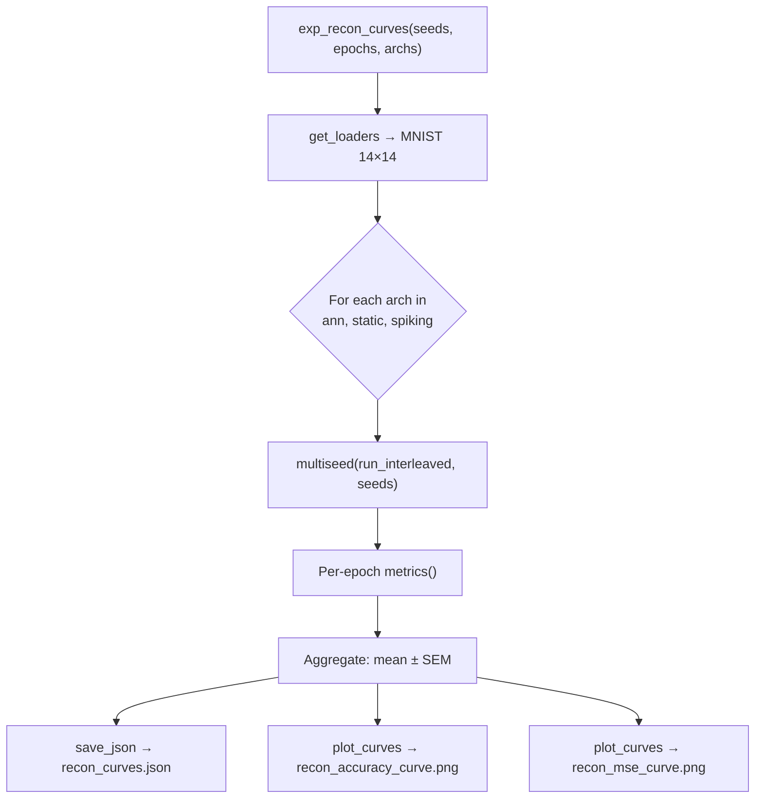
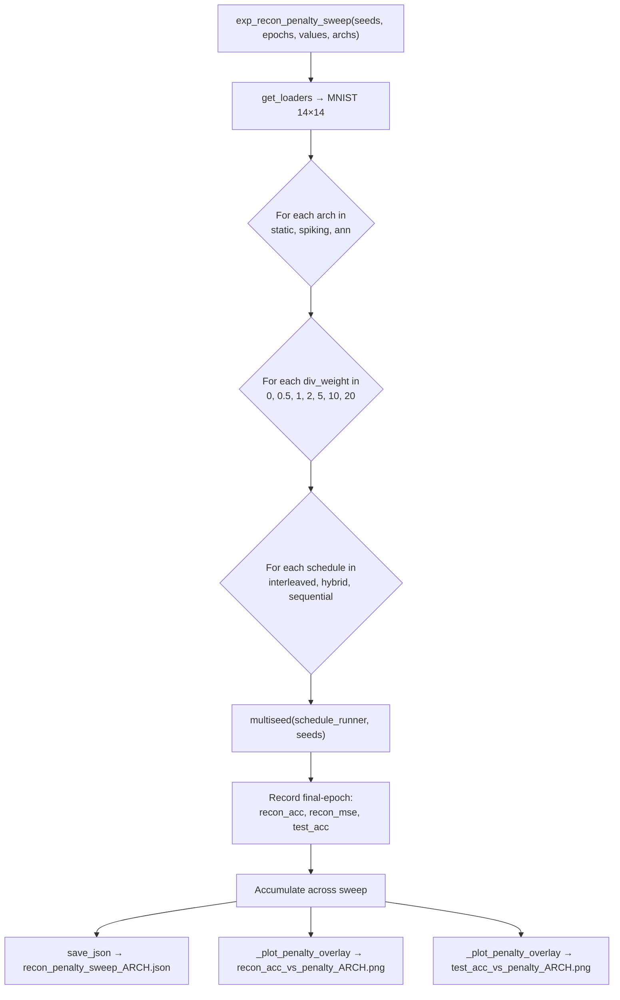
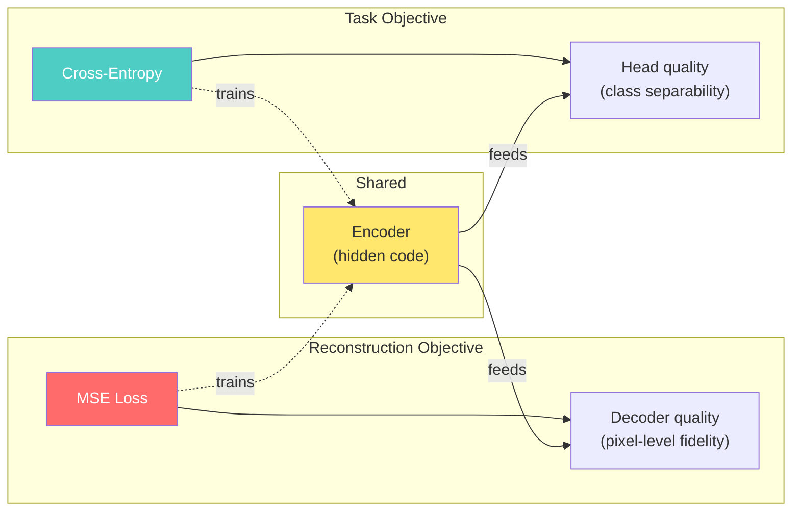

# Reconstruction Experiments: Code Layout & MSE–Accuracy Relationship

## 1. `recon_curves` — How It Works

### Entry Point: [exp_recon_curves](file:///d:/internship_autoencoder/Week_2/experiments.py#L568-L618)

This is a **dedicated, minimal experiment** that answers: *"How well does each autoencoder architecture reconstruct the input over training?"*

**What it does, step by step:**

1. **Loads data** — MNIST at 14×14, flattened to 196-d vectors.
2. **Loops over architectures** (`ann`, `static`, `spiking`) — each gets an independent set of training runs.
3. **Runs interleaved training** via `run_interleaved()` — a coin-flip schedule where each batch is randomly either a *task* cycle (cross-entropy on digit classification) or a *reconstruction* cycle (autoencoder MSE).
4. **Multi-seed aggregation** via `multiseed()` — runs each arch 10 times (or however many seeds), then computes mean ± SEM per epoch.
5. **Records two reconstruction metrics** from [metrics()](file:///d:/internship_autoencoder/Week_2/experiments.py#L30-L140) every epoch:
   - **`recon_mse`** — the raw MSE from `local_loss()`, the same quantity the autoencoder optimises. Lower = better.
   - **`recon_acc`** — `100 × (1 − mse / var(input))`, i.e. explained variance as a percentage. Higher = better.
6. **Outputs** to `recon_curves/`:
   - `recon_curves.json` — full per-epoch mean/SEM data for all metrics (acc, eff_rank, recon_mse, recon_acc, etc.)
   - `recon_accuracy_curve.png` — overlay of all archs, recon_acc rising over epochs
   - `recon_mse_curve.png` — overlay of all archs, recon_mse falling over epochs

> [!NOTE]
> NN is **excluded by default** because it has no autoencoder — `metrics()` returns `-1` for both recon fields. Only architectures with genuine encoder-decoder structure are meaningful here.

---

## 2. `recon_penalty_sweep` — How It Works

### Entry Point: [exp_recon_penalty_sweep](file:///d:/internship_autoencoder/Week_2/experiments.py#L723-L813)

This experiment answers a harder question: *"What is the tradeoff between neuron diversity (decoder penalty) and reconstruction/task accuracy, and does it depend on the training schedule?"*

**What it does, step by step:**

1. **Defines three schedule runners** at each penalty strength `v`:
   - **Interleaved** — coin-flip task/AE throughout, penalty applied on every AE cycle
   - **Hybrid** — warm-up AE phase (with penalty), then hand off to interleaved (penalty continues)
   - **Sequential** — Phase 1: AE-only training (with penalty); Phase 2: frozen task training
2. **Sweeps `div_weight`** across `[0, 0.5, 1, 2, 5, 10, 20]` — the decoder-orthogonality penalty that pushes neurons' decoder vectors apart.
3. **For each combination** (arch × div_weight × schedule), runs `multiseed()` and records the **final-epoch** recon_acc, recon_mse, and test accuracy.
4. **Outputs** per architecture (3 archs × 3 output types = 9 files):
   - `recon_penalty_sweep_ARCH.json` — raw sweep data
   - `recon_acc_vs_penalty_ARCH.png` — reconstruction accuracy vs penalty strength (1 line per schedule)
   - `test_acc_vs_penalty_ARCH.png` — test classification accuracy vs penalty strength (1 line per schedule)

> [!IMPORTANT]
> ANN is included as a **control** — it has a shared decoder (not per-neuron), so the decoder-orthogonality penalty acts on different structure. Any effect seen in ANN vs static/spiking tells you whether the penalty's impact is NAN-specific.

---

## 3. The Relationship Between MSE Loss and Accuracy

This is the central finding these two experiments reveal. Here's **why** you should care and **what** the data shows.

### 3.1 They Are Trained by **Different, Non-Overlapping Losses**

The code explicitly separates two learning signals that *never mix*:

| Signal | What it optimises | Which parameters |
|---|---|---|
| **Task loss** (cross-entropy) | Classification accuracy | Head weights (and encoder in interleaved) |
| **Reconstruction loss** (MSE) | Autoencoder fidelity | Encoder + decoder weights |

In `run_interleaved()`, each batch is either a task cycle OR an AE cycle — never both simultaneously. This means **recon_mse and accuracy move independently**. A model can reconstruct well but classify poorly, or vice versa.

### 3.2 What the `recon_curves` Data Shows

From the JSON results (15 epochs, interleaved, hidden=128):

| Arch | Final Recon Acc (%) | Final Recon MSE | Final Test Acc (%) |
|---|---|---|---|
| **ANN** | 77.8 | 0.0214 | 96.7 |
| **Static** | 32.9 | 0.0647 | 96.7 |
| **Spiking** | 32.5 | 0.0651 | 97.0 |

> [!WARNING]
> **Critical observation:** Static and spiking achieve *nearly identical test accuracy* to ANN (~96.7–97.0%) despite having **dramatically worse reconstruction** (~33% vs ~78% recon_acc, ~3× higher MSE). This is the key decoupling.

**Why?** The NAN (static/spiking) decoder is per-neuron — each neuron independently reconstructs the *entire* input from its single scalar. That's an extremely hard task and the MSE plateaus high. But the *encoder activations* still carry enough information for the classification head to work with, because the head doesn't need pixel-perfect reconstruction — it just needs the 128-d hidden code to be linearly separable by digit class.

### 3.3 What the `recon_penalty_sweep` Data Shows

The penalty sweep for **static** architecture reveals:

| div_weight | Interleaved Acc | Sequential Acc | Recon Acc (Interleaved) |
|---|---|---|---|
| 0 | 95.6% | 28.8% | 33.0% |
| 0.5 | 95.7% | 19.2% | 30.4% |
| 2 | 95.7% | 59.1% | 30.3% |
| 5 | 95.7% | 83.0% | 30.3% |
| 10 | 95.7% | 88.1% | 30.3% |
| 20 | 95.7% | 89.5% | 30.2% |

**Three takeaways:**

1. **Interleaved accuracy is immune to the penalty** — stays rock-steady at ~95.7% regardless of div_weight. The task signal compensates every step.

2. **Sequential accuracy dramatically *needs* the penalty** — without it (dw=0), sequential collapses to ~29% (near chance for 10 classes). As penalty increases, accuracy recovers toward 89%. The penalty fights representation collapse during the frozen Phase 1, giving Phase 2 something useful to classify with.

3. **Reconstruction accuracy drops but accuracy doesn't** — recon_acc falls from ~33% to ~30% as penalty increases, yet test accuracy is unchanged (interleaved) or *dramatically improves* (sequential). This confirms that **better reconstruction ≠ better classification**.

### 3.4 The Conceptual Model

The encoder is the **shared bottleneck**. Both losses shape it, but for different purposes:
- MSE wants a code from which the full 196-pixel input can be recovered.
- Cross-entropy wants a code in which the 10 digit classes are linearly separable.

These goals are **compatible but not identical**. A 128-d code that perfectly separates digits doesn't need to retain sub-pixel detail. Conversely, a code that retains every pixel still needs the head to find the class boundaries.

> [!TIP]
> **Bottom line for your research:** Reconstruction MSE is a measure of autoencoder health, *not* a proxy for task performance. The decoder penalty sacrifices a small amount of reconstruction fidelity to fight neuron collapse, and the task head doesn't notice. Track MSE to diagnose the autoencoder; track test accuracy to evaluate the model.
